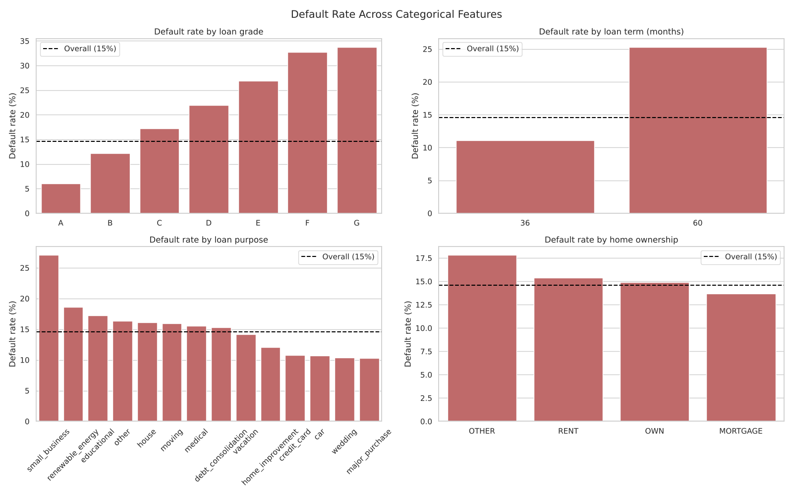
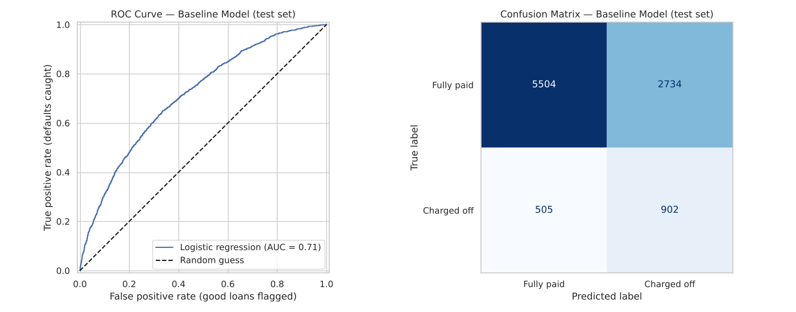

### Predicting Personal Loan Default

#### Executive summary
This project asks whether a lender can predict which personal loans will default, using only information available when the loan is approved. I used LendingClub's public data on 38,577 completed loans (2007–2011). The work covered cleaning the data, exploring what separates loans that were repaid from those that defaulted, and building a baseline logistic regression model.

About **1 in 7 loans (14.6%) defaulted**. The clearest warning signs are a high interest rate / low loan grade, a 60-month term, a small-business purpose, borrowing a lot relative to income, and heavily used credit lines. The baseline model ranks borrowers well (**ROC-AUC 0.71**) and catches **64% of defaults**. Loans it places in its riskiest 10% default 36.5% of the time, against 2.6% for its safest 10%.

#### Rationale
When a borrower stops paying, the lender loses the money still owed, and those losses are passed on to every borrower as higher interest rates. Many lending decisions still rely on a few fixed rules, such as a credit score cut-off. These can approve risky borrowers while turning away people who would have repaid. Spotting higher-risk applications early lets a lender review them more carefully, adjust the rate or loan amount, or ask for more information. That means fewer losses for the lender and fairer, more consistent decisions for applicants.

#### Research Question
Can we predict whether a borrower will default on a personal loan, using only the information available when the loan is approved?

#### Data Sources
- **LendingClub loan data, 2007–2011** (`data/lending_club_loans_2007_2011.csv`). This is LendingClub's public loan file: 39,717 loans with 111 columns covering loan terms, borrower profile, credit history and final loan status.
- **Change since Module 16:** I originally planned to use the larger 2007–2018 LendingClub file on Kaggle (about 2.2 million loans). I switched to the 2007–2011 file because it has the same key fields and every loan in it has a known final outcome. It is also small enough to clean, explore and model fully.

#### Methodology
- **Cleaning:**
  - Kept only finished loans (Fully Paid or Charged Off).
  - Removed 54 empty columns, constant columns, identifiers and free-text fields.
  - Removed every column recorded *after* the loan was issued (payments, recoveries), to avoid leaking the outcome.
  - Converted text fields (interest rate, term, employment length, dates) to numbers.
  - Filled the small number of missing values.
- **Feature engineering:**
  - credit history length (years)
  - loan-to-income ratio
  - monthly payment-to-income ratio
  - a "has derogatory record" flag
  - log of income
  - issue year
- **Outlier analysis:** used the IQR rule. Extreme incomes (up to \$6M), revolving balances and ratios were capped at the 99th percentile rather than deleted.
- **Exploratory analysis:** default rates by grade, term, purpose, home ownership, verification, employment length and year; distributions of continuous features for repaid vs defaulted loans; a correlation heatmap.
- **Baseline model:** logistic regression with one-hot encoding and scaling, `class_weight='balanced'`, a stratified 75/25 train/test split, and 5-fold cross-validation.
- **Evaluation metric:** **ROC-AUC** is the main metric. With only 15% defaults, a model that approves everyone is 85% accurate but catches no defaults, so accuracy is misleading. ROC-AUC measures how well the model *ranks* borrowers by risk, which is what a lender needs. Recall (defaults caught) and precision (flagged loans that really default) are reported alongside it.

#### Results
- **Default rate by grade:** 6% for grade A, rising to 34% for grade G. The cheapest 20% of loans by interest rate default 5% of the time; the most expensive 20% default 26%.
- **60-month loans** default more than twice as often as 36-month loans (25% vs 11%).
- **Small-business loans** are the riskiest purpose (27%). Car, credit card, wedding and major-purchase loans are the safest (10–11%).
- **Defaulters** had lower incomes (median \$53K vs \$60K), borrowed more relative to income (0.20 vs 0.16), and used more of their available credit (58% vs 48%).
- **Little or no effect:** years employed and length of credit history make little difference. Loans with verified income actually default *more*, likely because riskier applications were the ones chosen for verification.
- **Baseline model (test set):**
  - **ROC-AUC 0.71** (cross-validation 0.709 ± 0.013)
  - **recall 64%**, **precision 25%**
  - accuracy 66%, against 85% for the naive model, which catches no defaults
  - the riskiest 10% of loans by model score default **36.5%** of the time; the safest 10% default **2.6%**

#### Next steps
- Compare more models (decision tree, random forest, gradient boosting, KNN) against this baseline, tuned with grid search and cross-validation.
- Choose a decision threshold based on the cost of a missed default versus the cost of reviewing a good loan.
- Remove overlapping features (for example grade vs interest rate) to make the model easier to explain.
- Test on later loans (train on 2007–2010, test on 2011) to check the model holds up over time.
- Turn the results into a simple risk-tier table and rules that non-technical lending staff can use.

#### Outline of project

- [Initial report, EDA and baseline model](notebooks/loan_default_eda_baseline.ipynb)
